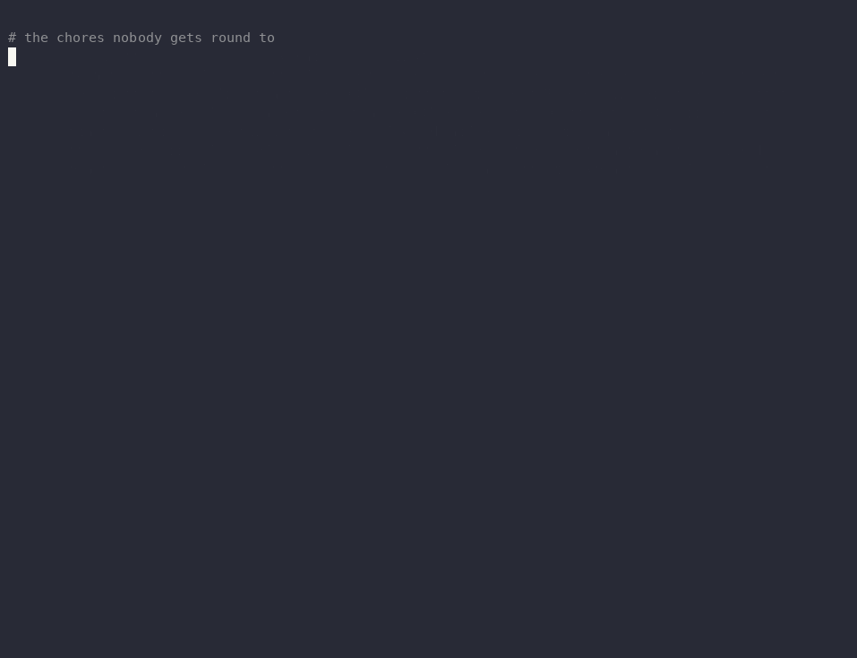

# nightshift-sloth

**One chore a night.** While you sleep, an open-weight model picks the next item off your
`CHORES.md`, does it on a throwaway branch with a strict time budget, runs your tests, and
leaves a morning report. It never merges, never pushes, never touches `main`. You read the
report over coffee and decide: keep it or bin it.

Built on [Backboard R-CLI](https://github.com/Backboard-io/Backboard-R-CLI) (MIT), the
open-source terminal coding agent, running headless against open-weight models on
[Nebius Token Factory](https://tokenfactory.nebius.com/). No Backboard account needed.



## Results: four open-weight models, six chores

Each model took each of the six chores in the demo repo once: 24 nights of work, run back to back
on 24 October 2026. A chore counts as **done** only if the repo's tests pass *and* a hidden
acceptance check, which the agent never sees, passes on the sloth branch.

| Model (on Nebius Token Factory) | Done | Tests green | Median wall time | Cost, all 6 chores | Cost per done chore |
|---|---|---|---|---|---|
| MiniMax M3.1 Flash | **6/6** | 6/6 | 50s | $0.068 | $0.011 |
| DeepSeek V4 Flash | 5/6 | 6/6 | 13s | **$0.013** | **$0.0026** |
| Qwen3-235B-A22B-Instruct-2507 | 3/6 | 6/6 | 16s | $0.093 | $0.031 |
| gpt-oss-120b | 3/6 | 3/6 | 11s | $0.216 | $0.072 |

Every chore was done by at least one model. Chore-by-chore results, with a link to every morning
report, are in [`docs/runs/SUMMARY.md`](docs/runs/SUMMARY.md).

What the numbers say:

- **Green tests are not the same as done.** Four branches passed the repo's own tests and still
  failed the hidden check. The clearest case is `utcnow-deprecation`: the chore says old ledgers
  hold naive timestamps and must keep working. DeepSeek and Qwen swapped `utcnow()` for
  `now(timezone.utc)` and stopped; the suite stayed green, and `tally list` then crashed on any
  ledger that mixed old and new entries. Only MiniMax normalised old timestamps and tested the mix.
- **The price that matters for an agent is the cached-input price.** Between 70% and 98% of every
  model's input tokens were cache hits, because an agent re-sends the same growing conversation on
  every call. DeepSeek bills cache hits at $0.01 per million tokens; Qwen and gpt-oss get no cache
  discount on this provider, which is most of why Qwen cost seven times as much as DeepSeek.
- **gpt-oss-120b didn't work with this setup.** In every run it produced malformed tool calls:
  missing arguments, invented tool names (`print_tree`, `search`), and harmony `<|channel|>` tokens
  leaking into tool names. One run burned 92 calls and $0.14 before the provider returned an error,
  which is why the harness now stops a run after six tool errors in a row. I did not work out
  whether the model, the provider's chat-completions translation or the agent's OpenAI adapter is
  at fault, so read that row as "this combination doesn't work yet", not as a verdict on the model.
- **Slow can be right.** MiniMax was the slowest model and the only one to finish all six. It was
  also the only one to run the suite with `-W error::DeprecationWarning` without being asked.

Caveats: one run per model per chore, so these are anecdotes with receipts, not a benchmark. The
demo app and its chores were written for this project, and the hidden checks were validated
(reject the untouched repo, accept a reference solution) before any model saw the chores.

One run was redone. In the first bench, worktrees shared refs with the repo, and MiniMax used
`git log --all` to read DeepSeek's earlier attempt at the same chore. That run is kept, with the
details, in [`docs/runs-excluded/`](docs/runs-excluded/); since then every night works in a private
clone, and the clean re-run is the one counted above.

**Total spend for the whole project: $0.45** of a self-imposed $3.00 cap, according to
[`ledger/spend.jsonl`](ledger/spend.jsonl). That covers every model call: smoke tests, the bench,
one aborted run, the excluded run and the demo recording.

## Why

Every repo has a list of chores nobody wants: the TODO that says *"blows up on a fresh install"*,
the deprecation warning that prints on every run, the README that drifted three releases ago,
the function with no tests "because it's simple". None of them is hard. All of them lose to
whatever is more interesting today.

They are also exactly the size of task a cheap model can do well, as long as someone keeps it on a
short leash. nightshift-sloth is the leash:

- **one chore per night**, the first open item in `CHORES.md` that has no `sloth/` branch yet;
- **a time budget** given to the agent (R-CLI's `--timer`) and a **hard kill** at budget + grace;
- **a dollar cap** per run, metered live from the agent's own token-usage events;
- **a private throwaway clone** on its own branch, `sloth/<chore>/<stamp>-<model>`, fetched back
  into your repo when the night is over;
- **your tests before and after**, and a **morning report** with the diff stat, test results,
  tokens, cost, model, and the exact commands to keep or discard the change.

Slow and steady: one small, reviewable change a day, for a fraction of a cent.

## How it works

```
CHORES.md ──► pick next open chore
                 │
                 ▼
private clone of main's history only ──► new branch sloth/<chore>/<stamp>-<model>
                 │   (no remote, none of your other branches; your repo is not touched)
                 │
                 ▼
tests before ──► backboard --print "<chore>" --timer 600 --format json --permission-mode bypass
                 │   │
                 │   ├─ fresh throwaway HOME: ~/.backboard/config.json knows one provider
                 │   ├─ scrubbed env: PATH, HOME, TMPDIR, locale + the one provider key
                 │   ├─ deny rules: no git push/commit/checkout, no gh, curl, installs, env dumps
                 │   ├─ no web tools (WebSearch, FetchUrl excluded)
                 │   └─ every `usage` event priced live ──► ledger.jsonl ──► kill at $ cap
                 │
                 ├─ hard kill of the whole process group at timer + grace
                 ▼
tests after ──► local commit ──► branch fetched back into your repo ──► (bench: hidden check)
                 │
                 ▼
MORNING_REPORT.md + run.json + diff.patch + R-CLI transcript
```

The agent is [Backboard R-CLI](https://github.com/Backboard-io/Backboard-R-CLI). nightshift-sloth
is a small Python harness (standard library only, about 1,500 lines) around it.

## Quick start

You need Python 3.11+, git, [ripgrep](https://github.com/BurntSushi/ripgrep) and
[Bun](https://bun.sh/) (to build R-CLI).

**1. Build R-CLI from source.** The macOS arm64 binary from the official download link, as
fetched on 24 October 2026 (`backboard` 3.0.5), did not support custom model providers or
`--timer`; both are on `main`. Build the commit this project was tested with (it reports its
version as 3.0.4, one below that release; that is not a typo here):

```sh
git clone https://github.com/Backboard-io/Backboard-R-CLI.git && cd Backboard-R-CLI
git checkout 51bee17e02344de5fffd89523ce2b73d5042f216
bun install --frozen-lockfile && bun run build      # produces ./backboard
export NIGHTSHIFT_RCLI="$PWD/backboard"
```

**2. Give it a model provider key.** Any OpenAI-compatible endpoint works; the defaults use
Nebius Token Factory. The key is read from your environment and only ever passed to the agent
process; it is never written to disk by nightshift-sloth.

```sh
export NEBIUS_API_KEY=...        # never commit this
```

**3. Try it on the demo repo**, a tiny expense tracker with six real chores:

```sh
git clone https://github.com/Bowen1314/nightshift-sloth.git && cd nightshift-sloth
bin/nightshift-sloth demo ~/tallyho
bin/nightshift-sloth night --repo ~/tallyho
cat ~/.nightshift-sloth/reports/LATEST.md
```

**4. Point it at your own repo.** Add a `CHORES.md`:

```markdown
---
test: python3 -m unittest discover -s tests
timer: 600
---
- [ ] fix-empty-report: `tally report` crashes on an empty ledger. Print "No entries yet." instead.
- [ ] readme-usage-drift: the Usage section no longer matches `--help`. Fix it.
```

Then run it nightly. `bin/nightshift-sloth schedule --repo ~/code/myapp` prints a launchd plist
(macOS) and a cron line; nightshift-sloth does not install anything for you.

## Commands

| Command | What it does |
|---|---|
| `night --repo R [--chore ID] [--model M]` | Do one chore now. Without `--chore`, takes the first open chore with no `sloth/` branch. |
| `bench --repo R --models a,b,c --checks DIR` | Every chore × every model, plus hidden acceptance checks. Writes `SUMMARY.md`. |
| `summary` | Rebuild `SUMMARY.md` from a report folder. |
| `ledger` | Spend so far, per model, against the cap. |
| `prices` | Live per-token prices for the configured models. |
| `demo DIR` | Create the tallyho demo repo. |
| `schedule --repo R` | Print a launchd plist / cron line for a nightly run. |

Common flags: `--out` (report folder), `--ledger` (spend ledger; or set `NIGHTSHIFT_LEDGER`), `--key-file` (dotenv file with
the key, instead of the environment), `--config` (defaults to `nightshift.toml`).

## Configuration

`nightshift.toml` holds the provider, the models and the budget. No secrets.

```toml
[provider]
base_url = "https://api.tokenfactory.nebius.com/v1"
key_env = "NEBIUS_API_KEY"

[budget]
total_usd = 3.00     # the ledger refuses to start a run that could cross this
per_run_usd = 0.25   # a run is killed the moment its metered cost reaches this

[night]
timer = 600          # handed to R-CLI's --timer (advisory, for the model)
grace = 120          # hard kill at timer + grace (enforced by nightshift-sloth)

[[models]]
alias = "deepseek-v4-flash"
id = "deepseek-ai/DeepSeek-V4-Flash-0731"
```

Swapping models is one line. Swapping providers is two (`base_url`, `key_env`); prices are
fetched live from the provider's `/models` endpoint, so the ledger is always billed at the
current list price.

## What the sloth can and cannot do

R-CLI runs headless with `--permission-mode bypass`, because nobody is awake to approve
prompts. That is only acceptable because of what surrounds it:

- It works in a **private clone** that holds only the base commit's history, on its own branch,
  with no remote. It cannot see your other branches (or earlier sloth attempts), and it cannot
  move your refs. The harness fetches the one sloth branch back afterwards.
- It gets a **throwaway HOME** and a **scrubbed environment**. Your shell's other API keys
  (`OPENAI_API_KEY`, `BACKBOARD_API_KEY`, ...) never reach it, nor does your git identity or
  credential helper (`GIT_CONFIG_GLOBAL=/dev/null`, `GIT_CONFIG_NOSYSTEM=1`).
- R-CLI **deny rules** (which outrank bypass mode in its permission engine) block `git push`,
  `git commit`, branch switching, `gh`, `curl`, package installs and environment dumps.
- Web tools are switched off; the only network it needs is the model endpoint.
- The **process group is killed** at timer + grace, and at the per-run dollar cap.
- The harness, not the agent, makes the one local commit on the sloth branch.

It is **not a sandbox**: the agent can still run shell commands as your user inside that
clone and could, if it went badly wrong, touch files elsewhere. Use it on repos you would
let a junior colleague work on unsupervised, ideally on a dev machine. Evidence files are
scrubbed of the key and of local absolute paths before they are written.

## Repository layout

```
nightshift_sloth/     the harness (stdlib only)
  night.py            one chore: private clone → R-CLI → tests → commit → report
  rcli.py             R-CLI runner: throwaway HOME, scrubbed env, live metering, hard kill
  chores.py           CHORES.md parser
  report.py           morning reports and the bench summary
examples/tallyho/     the demo app and its CHORES.md
bench/tallyho-checks/ hidden acceptance checks (one per chore), never shown to the agent
bench/tallyho-reference/  reference solutions the checks were validated against
docs/runs/            every bench run: MORNING_REPORT.md, TRANSCRIPT.md, run.json, diff.patch, events
docs/runs-excluded/   runs kept as evidence but left out of the numbers, and why
ledger/spend.jsonl    every model call this project made, priced
tests/                tests for the harness itself
```

## Timeline

Built from 24 to 25 October 2026 for the
[DEV Hacktoberfest Open-Source AI Challenge, week 3](https://dev.to/challenges/hacktoberfest-week3-2026-10-19).
Any commit made after the deadline (25 October 2026, 23:59 PDT) will be listed here.

## License

MIT. Backboard R-CLI is MIT-licensed by Backboard.
